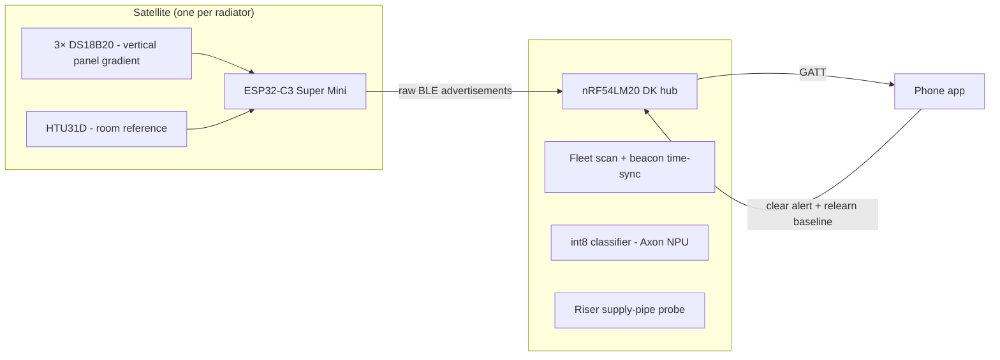

<div align="center">

# Cieplik

**Cieplik uses a fleet of sensors on radiators connected to an nRF54LM20 hub via BLE to detect heating issues before you feel them.**

My entry for the Nordic Semiconductor / Hackster **Sustain the System** contest - [project page](https://www.hackster.io/matteuschger/cieplik-radiator-fleet-guardian-f34ad1)

[](https://www.espressif.com/en/products/socs/esp32-c3)
[](https://www.nordicsemi.com)
[](LICENSE)

</div>

## How it works

### Satellites
One battery-powered ESP32 C3 Super Mini per radiator, each carrying three DS18B20 probes on a single 1-Wire bus, measuring the vertical thermal gradient of the panel, plus an HTU31D as the room-air reference. Satellites are put in deep sleep between readings and broadcast them as raw BLE advertisements.

### Hub
An nRF54LM20 DK next to the riser. It scans the fleet, time-syncs the satellites from its beacon, and runs a fault classifier. It also hosts the riser supply-pipe probe, which is what separates "my radiator is failing" from "the building is sending cold water". The hub links to a phone app.

### App
A simple Android phone app that logs the errors and allows the user to view the data and data history live. The user can also clear the alerts in the app once maintenance is done.



Clearing an alert from the app is what closes the loop: after maintenance, the satellite relearns its thermal baseline. If the fault was not actually fixed, the classifier flags the same radiator again on the next heating cycle. Self-correcting by design.

## Faults it detects

Every heating cycle, each radiator is labelled with one of:

* Air lock - the top of the panel stays cold
* Sludge - the bottom of the panel stays cold
* Stuck TRV
* Radiator covered by curtains or furniture
* Window open while heating
* Empty-room heating
* Fleet imbalance
* Building supply problem - caught by the hub's riser supply-pipe probe, not blamed on the radiator

## Status

In active development, and honest about it:

* Satellite firmware bring-up is under way on real hardware: the HTU31D room sensor is verified on the bench, and bus communication basics are committed.
* The nRF54LM20 DK (the designed hub) is pending the contest hardware announcement on Nov 20. Until then a laptop acts as a temporary demo hub - the fleet does not wait for hardware.
* The phone app and the on-device classifier come next, once the fleet is logging.

## Hardware

| Component | Role |
| --- | --- |
| ESP32-C3 Super Mini | Satellite MCU, one per radiator |
| DS18B20 ×3 | Vertical panel gradient probes, single 1-Wire bus |
| HTU31D | Room-air reference (temperature and humidity) |
| nRF54LM20 DK | Hub: fleet scan, beacon time-sync, int8 fault classifier on the Axon NPU, riser supply-pipe probe |
| LiPo cell | Satellite power; deep sleep between readings |

## Satellite wiring

| Signal | Pins | Notes |
| --- | --- | --- |
| 1-Wire bus, 3× DS18B20 | GPIO10 | one 4.7 kΩ pull-up to 3V3 for the whole bus |
| HTU31D (I2C) | GPIO4 (SDA), GPIO5 (SCL) | mounted on the satellite board, reads clean room air |

DS18B20 probes are mounted with thermal paste and a zip tie - dry taping reads low.

## Repository structure

```
Satellites/Code/CieplikSatellite/   Satellite firmware (PlatformIO + ESP-IDF)
```

The hub and the phone app will join as their development starts.

## Building the satellite firmware

The satellite is a [PlatformIO](https://platformio.org/) project on the ESP-IDF framework:

```
cd Satellites/Code/CieplikSatellite
pio run
```

## License

GPL-3.0 - see the [LICENSE](LICENSE) file.
