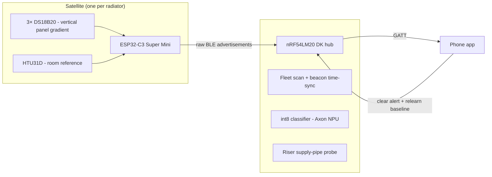

# Cieplik
Cieplik uses a fleet of sensors on radiators connected to an nRF54LM20 hub via BLE to detect heating issues before you feel them. 

Also my entry for the Nordic Semiconductor / Hackster "Sustain the System" contest - predictive maintenance on nRF54LM20 + Bluetooth: https://www.hackster.io/matteuschger/cieplik-radiator-fleet-guardian-f34ad1

## How it works

### Satellites
One battery-powered ESP32 C3 Super Mini per radiator, each carrying three DS18B20 probes on a single 1-Wire bus, measuring the vertical thermal gradient of the panel, plus an HTU31D as the room-air reference. Satellites are put in deep sleep between readings and broadcast them as raw BLE advertisements.

### Hub
An nRF54LM20 DK next to the riser. It scans the fleet, time-syncs the satellites from its beacon, and runs a fault classifier. It also hosts the riser supply-pipe probe, which is what separates "my radiator is failing" from "the building is sending cold water". The hub links to a phone app.

### App
A simple Android phone app that logs the errors and allows the user to view the data and data history live. The user can also clear the alerts in the app once maintenance is done.

